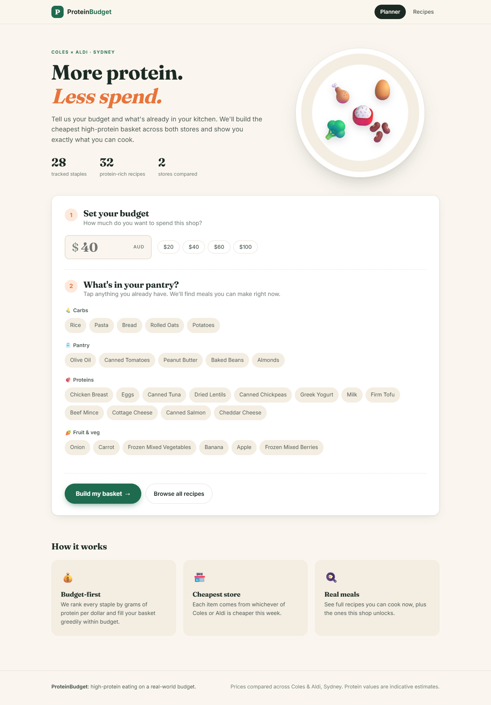
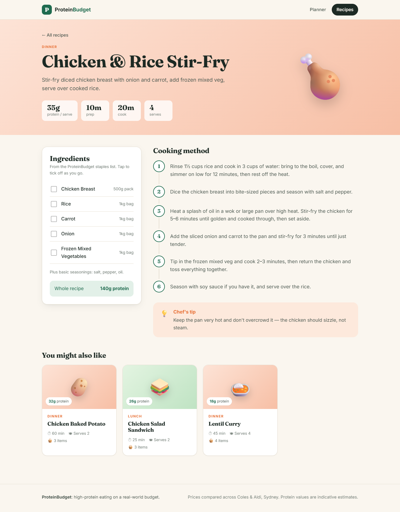

# ProteinBudget Planner

Find the cheapest way to spend a grocery budget across Coles and Aldi in Sydney,
and see which high-protein meals it unlocks - including meals you can already make
from what's in your pantry.

Built as a data science / applied engineering portfolio project: a small end-to-end
pipeline (scrape, cache, optimize, serve) with a pandas/Jupyter analysis layer on
top of the same data.



| Recipe page |
|---|
|  |

## Why this exists

Grocery budgeting advice online is generic. This project answers a more specific
question: given a fixed number of dollars and the items already in your kitchen,
what is the highest-protein set of meals available to you right now, and what does
spending the rest of the budget unlock?

## Features

- Meal-first budget optimizer: builds a basket from about 28 tracked grocery staples
  that completes as many high-protein meals as your budget allows, never re-buys what's
  already in your pantry, tops up leftover budget with the best protein-per-dollar
  items, and picks whichever of Coles or Aldi is cheaper for each item.
- Pantry-aware meal matching: tick off what you already have, and the app shows
  full high-protein meals you can make right now, separately from meals a shop would
  unlock.
- Recipe cookbook: a searchable, filterable `/recipes` page with all 32 meals, and a
  page per recipe with ingredients, step-by-step cooking method, prep/cook times and a tip.
- Live price scraping: a Playwright-driven scraper fetches current prices from
  Coles and Aldi on demand, cached locally in SQLite so the app doesn't re-scrape on
  every request.
- Offline-friendly: ships with illustrative sample price data, so the app, tests,
  and notebook all work out of the box without installing a browser or scraping
  anything first.
- Data analysis notebook: a pandas/Jupyter notebook over the same price cache --
  protein-per-dollar rankings, a Coles-vs-Aldi price comparison, and price history
  over time as the cache accumulates scrapes.

## How it works

```
Scraper (Playwright) -> SQLite (prices.db) -> Optimizer / Meal Matcher -> FastAPI + HTML UI
                               |
                               v
                     pandas + Jupyter notebook   (separate, manual analysis)
```

1. You tick off items you already have and enter a budget.
2. The optimizer reads the latest cached prices and builds the basket in two phases,
   ignoring anything you've ticked as already owned:
   - Meals first: it repeatedly picks the recipe with the most protein per dollar of
     still-missing ingredients that fits the remaining budget, and buys those
     ingredients. Items you own, and items already in the basket, count toward later
     recipes, so shared staples make the next meal cheaper.
   - Protein top-up: any leftover budget goes on the best protein-per-dollar items,
     skipping any that don't fit but still filling in cheaper ones after them.
   Each basket line shows which meal it was bought for, or that it's a top-up.
3. The meal matcher checks the curated recipe catalog against (a) what you already
   have, and (b) what you have plus what the basket would add -- so you see "meals you
   can make right now" and "meals this shop unlocks" as two distinct lists.
4. If a scrape has never run, or fails, the app falls back to whatever is in the
   local price cache (including the bundled sample data) and shows a "prices last
   updated" timestamp so you always know how fresh what you're looking at is.

## Tech stack

Python 3.11+, FastAPI, Jinja2, Playwright (Chromium), BeautifulSoup4, SQLite,
PyYAML, pandas, matplotlib, pytest + pytest-asyncio

## Getting started

```bash
git clone <your-repo-url>
cd protein-budget-planner
python -m venv venv
venv\Scripts\activate
pip install -r requirements.txt
playwright install chromium
```

(Use `source venv/bin/activate` instead of `venv\Scripts\activate` on macOS/Linux.
Installing the Playwright browser is only needed if you want live scraping.)

See it working immediately, without scraping anything:

```bash
python sample_data/load_sample_data.py
python run.py
```

This opens `http://localhost:8000` in your browser with illustrative sample prices
already loaded -- enter a budget and try ticking a few pantry items.

Get real current prices:

```bash
python scraper/run_scrape.py
```

This scrapes Coles and Aldi for every tracked item and writes results into
`prices.db`, overwriting the sample data's effect (the app always uses whichever
price is most recent per item/store). Re-run it any time to refresh.

## Usage

1. Run `python run.py` -- it starts a local server and opens your browser.
2. Enter your budget, and optionally tick items you already have.
3. Submit. You'll see:
   - Meals you can make right now, from your ticked items alone.
   - Your basket -- the cheapest combination of tracked staples that fits your
     budget, with the store each item is cheapest at.
   - Meals you can make after this shop -- additional recipes unlocked by the
     basket, on top of what you already had.

## Data and methodology

- Tracked items: about 28 common grocery staples across protein, carbs, vegetables
  and fruit, and pantry categories, defined in `data/items.yaml` with a
  protein-per-100g value and a purchase unit size (e.g. a 500g pack).
- Recipes: 32 curated high-protein meals in `data/recipes.json`, each listing
  its ingredients (by item ID) and protein per serving. A recipe is "feasible" when
  every one of its ingredients is in the available item set -- there's no partial
  credit for having most of what a recipe needs.
- "Cheapest": for each tracked item, whichever of Coles or Aldi has the lower
  cached price. The optimizer completes meals first (ranked by recipe protein per
  dollar of missing ingredients), then fills leftover budget by protein-grams-per-dollar.
  This trades some raw grams of protein for a basket you can actually cook with.
- Aldi coverage is partial, by design: Aldi Australia doesn't sell groceries
  online store-wide -- it publishes a rotating weekly Specials catalogue. This project
  scrapes that Specials page, so many items will show "Coles only this week" rather
  than an Aldi price. That's expected, not a bug.

## Running the tests

```bash
pytest
```

All tests run against fixtures and an in-memory/temp SQLite database -- no network
calls, no live scraping, so they're fast and deterministic. The scraper's live-fetch
functions are exercised manually via `scripts/live_check.py`, not in the automated
suite (see below).

**Important note on this build:** the Coles/Aldi parser selectors and the two HTML
fixtures under `tests/fixtures/` were written without access to a live browser, so
they're best-guess placeholders, not confirmed against the real sites. Before trusting
live scraping, run `scripts/capture_fixture.py` for a real search, inspect the actual
markup, and update `PRICE_SELECTOR` in `scraper/coles.py` / `scraper/aldi.py` (and the
fixtures/expected prices in the matching tests) to match. See those files' docstrings.

## Checking the live scrapers still work

Site markup changes without notice. To manually confirm Coles/Aldi scraping still
works against the real sites:

```bash
python scripts/live_check.py
```

If a site's markup has changed, the price-parsing functions in `scraper/coles.py` and
`scraper/aldi.py` may need their CSS selector updated -- `scripts/capture_fixture.py`
re-captures a fresh sample page to develop against.

## The analysis notebook

```bash
python notebook/build_notebook.py
jupyter notebook notebook/analysis.ipynb
```

Reads `prices.db` if it exists (falling back to the bundled sample data otherwise)
and produces: a protein-per-dollar ranking, a Coles-vs-Aldi price comparison, and (once
the scraper has run more than once) a price-history view per item.

## Project structure

```
protein-budget-planner/
  core/          data models, item/recipe loaders, optimizer, meal matcher
  storage/       SQLite price cache
  scraper/       Coles/Aldi scrapers, price parsing, scrape orchestration
  web/           FastAPI app, HTML templates, static CSS
  notebook/      pandas/Jupyter analysis (generated via build_notebook.py)
  data/          items.yaml, recipes.json -- the static catalogs
  sample_data/   illustrative offline demo prices
  scripts/       live_check.py, capture_fixture.py -- manual dev tools
  tests/         pytest suite (fixtures, no live network calls)
  run.py         entry point
```

## Limitations and ethics

- This project accesses public Coles/Aldi web pages the same way a browser would, at
  low, manual, personal-use frequency -- it is not a commercial scraping operation,
  doesn't bypass any login, and isn't run on a schedule. That said, most retail sites'
  Terms of Service restrict automated access; use this responsibly, for personal
  budgeting only, and expect it to need occasional maintenance if a site's markup
  changes.
- Aldi coverage is limited to its published weekly Specials -- see "Data and
  methodology" above.
- Protein values and unit sizes in `data/items.yaml` are reasonable estimates for
  common product sizes, not pulled from a nutrition database -- treat them as
  indicative, not exact.
- This tool recommends what to buy; it doesn't place any order or interact with
  either retailer's checkout.
- The Coles/Aldi CSS selectors ship as best-guess placeholders (see the testing
  section above) -- confirm them against a live capture before relying on real
  scraped prices.

## Roadmap ideas

- Expand the tracked item list and recipe catalog.
- Add a third store once a reliable public data source is identified.
- Track price history long enough to show seasonal trends in the notebook.

## License

MIT -- see LICENSE.
